<h1 align="center">Vadim Bykov</h1>

  <b>DevOps Tech Lead</b> · 10+ years in IT, 7+ in DevOps

  

  
  

I work at [Silk Data](https://github.com/SilkData), a machine-learning R&D company. Most of my work is CI/CD pipelines and the infrastructure under them: Jenkins, GitLab CI, Terraform, Ansible and Kubernetes. I started as a sysadmin in 2013, moved to DevOps in 2018 and have led and mentored a team of two engineers.

<picture>
  <source media="(max-width: 600px) and (prefers-color-scheme: dark)" srcset="./assets/pipeline/dark-narrow.svg">
  <source media="(max-width: 600px)" srcset="./assets/pipeline/light-narrow.svg">
  <source media="(prefers-color-scheme: dark)" srcset="./assets/pipeline/dark.svg">
  
</picture>

How the pipelines I build usually look. The names under each step are the tools I've used for it in production.

## What I work on

**Media CMS.** Microservices behind a high-traffic media portal. I run the delivery pipelines for all environments and I'm building a new cloud production environment for it, fully described in code.

**Cross-platform product.** Backend, web and mobile apps. Build and release pipelines for every part, including the mobile apps and their distribution outside the app stores.

**Anti-plagiarism SaaS.** One pipeline builds a complete environment from scratch: cloud servers, security hardening, monitoring and deployment of all services.

**EdTech platform.** Deployment used to be manual. I turned it into repeatable automation, built cloud pipelines for every environment and moved the whole stack to a new OS.

## Stack

| Area | Tools |
|---|---|
| CI/CD & GitOps | &nbsp;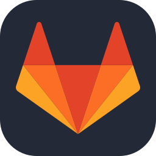&nbsp;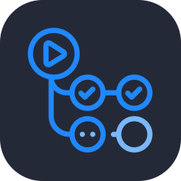&nbsp; |
| IaC & Config | 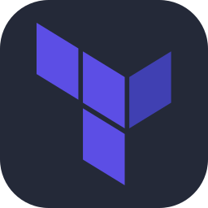&nbsp;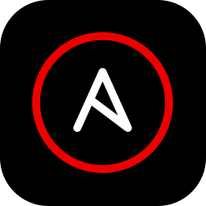&nbsp;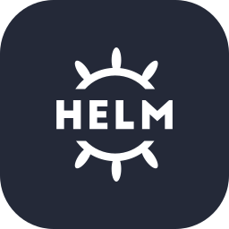 |
| Containers | &nbsp;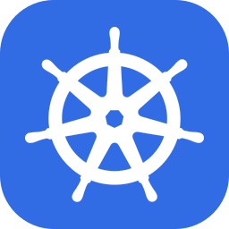 |
| Cloud | 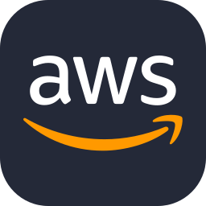&nbsp;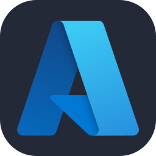&nbsp;&nbsp; |
| Observability & Security | 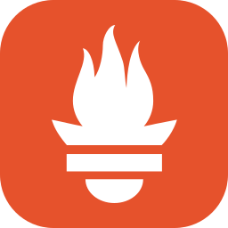&nbsp;&nbsp;&nbsp;&nbsp; |
| Edge & Networking | 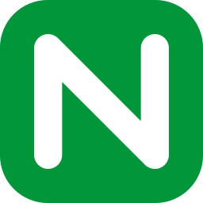&nbsp;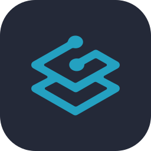&nbsp;&nbsp; |
| OS & Scripting | &nbsp; |
| Collaboration | &nbsp;&nbsp; |

Jenkins and Ansible run most of my deploys, GitLab CI builds the mobile apps, Terraform covers AWS, Azure, GCP and Hetzner. For new Kubernetes environments I use Helm and Argo CD. Monitoring and security: Prometheus, Grafana, Zabbix, ELK and Wazuh. Icons from [skill-icons](https://github.com/tandpfun/skill-icons) (MIT) and [Simple Icons](https://simpleicons.org) (CC0).

---

  <a href="https://www.linkedin.com/in/vadik-bkv">LinkedIn</a> ·
  <a href="mailto:vadim_bkv@yahoo.com">vadim_bkv@yahoo.com</a>

