# Cross-platform product

Backend, web and mobile apps · since 2018

<picture>
  <source media="(max-width: 600px) and (prefers-color-scheme: dark)" srcset="../assets/app-delivery/dark-narrow.svg">
  <source media="(max-width: 600px)" srcset="../assets/app-delivery/light-narrow.svg">
  <source media="(prefers-color-scheme: dark)" srcset="../assets/app-delivery/dark.svg">
  
</picture>

## Moving a legacy backend to Kubernetes

The backend used to run as Tomcat and MySQL directly on plain servers. I containerized it and moved it to Azure Kubernetes Service, back when that was not yet the usual move.

- File storage moved from local disks to Azure Blob Storage.
- MySQL moved from a Linux server to the managed Azure Database for MySQL.
- The heavy processing servers are driven by an Azure queue. They start only when a task lands in the queue and shut down when the work is done, so the big machines cost money only while they are busy. That kept the cloud bill low from day one.

## Every branch or tag

A multibranch Jenkins pipeline builds every branch and every tag. After the build, the test suites, split by area of the codebase, run in parallel with fail-fast, so a broken branch stops early. The image is built alongside, and the test reports are published with every run.

## Releases

A release is a form, not a script. You pick the release tag and tick the services to deploy. The pipeline then:

1. checks the parameters and the secrets it will need before touching anything, and lints the deploy code,
2. deploys only the picked services to stage with Ansible, and refuses to start while a database migration is still running,
3. waits until every rollout it started on stage is healthy,
4. once stage is fine, rolls the same release out to the clusters of several customers, release tags only,
5. updates a version page that shows what runs where.

## Dependency scan

A separate pipeline scans the dependencies of any branch for known vulnerabilities and publishes the report.

## Mobile apps

The Android and iOS apps are built by GitLab CI on a self-hosted Mac mini runner. An OTA server distributes the apps outside Google Play and the App Store.

**Tools:** Jenkins, Ansible, GitLab CI, Docker, Kubernetes (AKS), Azure Blob Storage, Azure Database for MySQL, Azure queues, OWASP Dependency-Check.

[Back to profile](../README.md)
