# Enterprise product

Release testing on four database engines

<picture>
  <source media="(max-width: 600px) and (prefers-color-scheme: dark)" srcset="../assets/db-matrix/dark-narrow.svg">
  <source media="(max-width: 600px)" srcset="../assets/db-matrix/light-narrow.svg">
  <source media="(prefers-color-scheme: dark)" srcset="../assets/db-matrix/dark.svg">
  
</picture>

## The problem

A Java server product that customers run on their own database: PostgreSQL, Oracle, MariaDB or MySQL. A release that works on one engine can still break a migration on another.

## The release check

One parameterized Jenkins pipeline runs the same check on every engine, one after another:

1. **DB up.** Ansible starts a fresh database container for the engine.
2. **Build + tests.** The server is built with that engine's profile and its unit tests run against it.
3. **Restore dump.** A production-like dump is loaded, so the migration meets real data, not an empty schema.
4. **Migrate.** The new server image starts and migrates the schema.
5. **Server up.** The pipeline waits for the service info endpoint to answer.

Each engine can be switched off for a quick run, the Oracle volume can be recreated from scratch, the whole run has a time limit, and a failure sends an email with the link to the build.

## Around it

The same product has its own pipelines for building and shipping images, acceptance tests, an antivirus scan of the build and a dependency audit. Deployments to each customer's environment go through Ansible, with a Helm chart for Kubernetes installs.

**Tools:** Jenkins, Ansible, Docker, Maven, PostgreSQL, Oracle, MariaDB, MySQL, Helm.

[Back to profile](../README.md)
